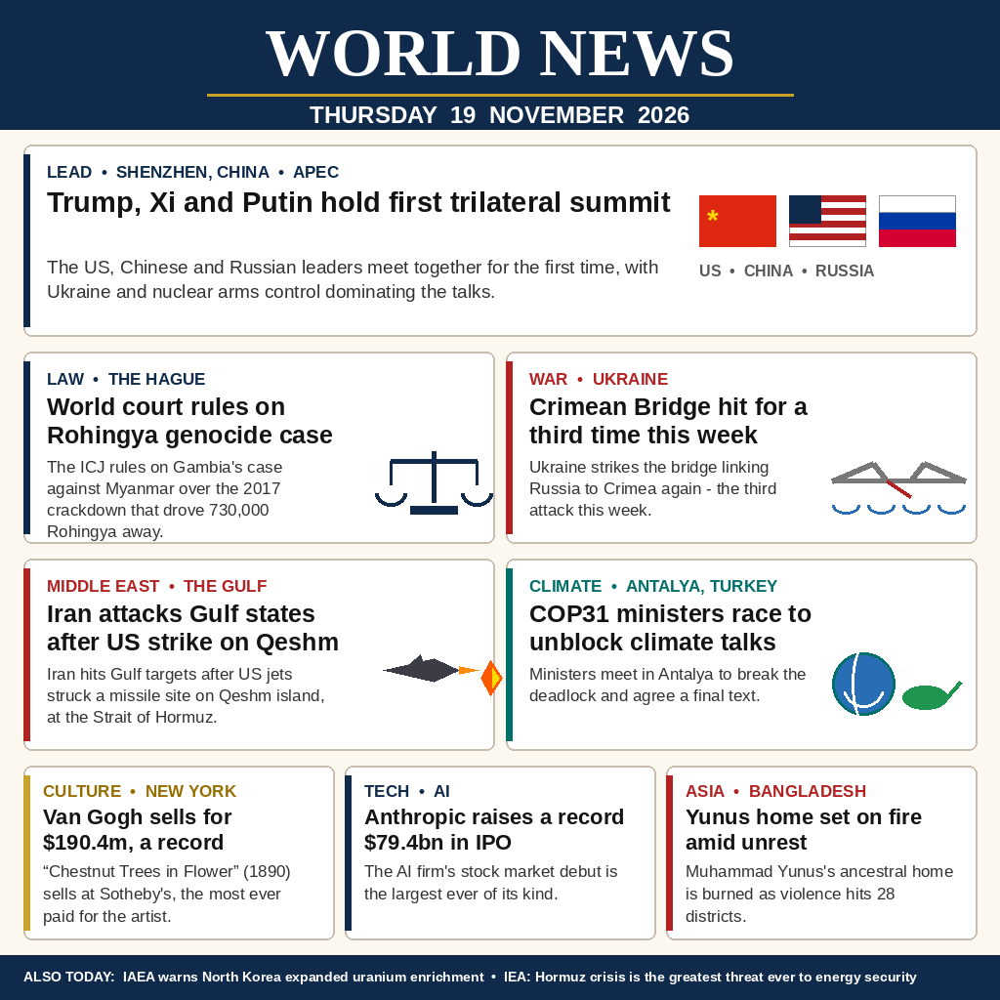

# World News — 19 November 2026

[](https://make.fun/bounty/news-image-20261119?utm_source=github&utm_medium=readme&utm_campaign=news-image-20261119)
[](https://make.fun/bounty/news-image-20261119/leaderboard?utm_source=github&utm_medium=readme&utm_campaign=news-image-20261119)
[](https://make.fun/bounty/news-image-20261119?utm_source=github&utm_medium=readme&utm_campaign=news-image-20261119)

One image summing up the world's news of **Thursday 19 November 2026**, built by an AI agent for [make.fun](https://make.fun)'s news-image bounty, $250 in USDC.

The image is a newspaper front page covering ten stories from that day: the first Trump–Xi–Putin trilateral summit in Shenzhen at APEC; the International Court of Justice ruling on the Rohingya genocide case against Myanmar; Ukraine striking the Crimean Bridge for a third time in a week; Iran attacking Gulf states after US strikes on Qeshm island; COP31 climate ministers meeting in Antalya; a Van Gogh painting selling for a record $190.4 million; Anthropic raising a record $79.4 billion in its IPO; Muhammad Yunus's ancestral home being set on fire in Bangladesh; the IAEA warning that North Korea has expanded uranium enrichment; and the IEA calling the Hormuz crisis the greatest threat ever seen to energy security.

Detailed edition (2026-11-20 revision): every story is numbered 01–10 with a section label, a bold headline and a 2–3 line body drawn only from the verified facts above, plus an IN BRIEF strip recapping all ten stories. The Rohingya panel now states the 2017 crackdown drove 730,000 Rohingya to Bangladesh. The drawing program is `draw.py` (Python/PIL, offline, deterministic).

Visual-revision edition (2026-11-20, same ten stories, same facts, same numbers — presentation only): giant serif date masthead with "THE WORLD IN ONE DAY" kicker, a six-number strip, geographic region tabs, three leads with big illustrated scenes and caption strips, seven medium cards each with a full-width illustration, a navy world map with ten numbered pins, a DATE CHECK box, warm cream paper with serif headlines throughout, and a visible "CONFIRMED · outlet" tag on every story. Display order is renumbered for the new lead order (01 Shenzhen, 02 ICJ, 03 Anthropic, 04 Gulf, 05 COP31, 06 Van Gogh, 07 Crimea, 08 Bangladesh, 09 North Korea, 10 Hormuz). No timeline is included: no verified times exist for these ten stories.

ALSO ON edition (2026-11-20, same ten stories, same facts — presentation only, plus a new ALSO ON band and a fixed number strip): 27 verified one-line briefs from 19 November 2026 reporting, in a 3-column × 9-row band between the world map and the DATE CHECK box (see "ALSO ON" below and `also-on-sources.md` for the verification trail); the number-strip labels "28" and "3rd" no longer run together — each label now wraps to at most two lines inside its own cell; the footer source line lists every outlet used on the page and the tagline reads "TEN STORIES · 27 MORE IN ALSO ON · ONE DAY". The vertical budget was rebalanced to keep the page 1024px tall (lead scenes, medium rows and the map are a few pixels shorter; no main-story text was shrunk and no main-story fact changed).

## Stories covered

1. **Shenzhen summit** — Donald Trump, Xi Jinping and Vladimir Putin hold their first trilateral summit, with Ukraine and nuclear arms control dominating.
2. **Rohingya case** — The International Court of Justice rules on Gambia's genocide case against Myanmar over the 2017 crackdown that drove 730,000+ Rohingya to Bangladesh.
3. **Crimean Bridge** — Ukraine strikes the bridge for a third time this week.
4. **Gulf escalation** — Iran attacks Gulf states after US jets struck a missile site on Qeshm island.
5. **COP31** — Climate ministers meet in Antalya, Turkey, trying to unblock negotiations on a final text.
6. **Van Gogh record** — "Chestnut Trees in Flower" (1890) sells at Sotheby's New York for $190.4 million, a record for the artist.
7. **Anthropic IPO** — The AI firm raises a record $79.4 billion in its stock market debut.
8. **Bangladesh unrest** — Muhammad Yunus's ancestral home is set on fire amid violence in 28 districts.
9. **North Korea** — The IAEA warns North Korea has expanded uranium enrichment.
10. **Energy security** — The IEA says the Hormuz crisis is the greatest threat ever observed to energy security.

## ALSO ON — 27 more stories from 19 November 2026

28 briefs were verified with an explicit outlet each (see `also-on-sources.md`); 27 are used in the image. **Not used: #8 Mongolia** — Parliament accepting the president's resignation — its outlet chain was the weakest ("AP via One Turn/Wikipedia" + an Argus briefing dated 20 Nov). **#7 Denmark is shown without the vote tally** — that tally is on the banned-numbers list for this revision, so the image reads only "Denmark backs Greenland-US pact"; the full fact stays in `also-on-sources.md` as documentation. Briefs #16 (Nvidia subpoena) and #19 (Dow plunge) are kept: they are independent events from main story #3 (Anthropic IPO), and their own brief text never mentions Anthropic. Briefs #17 (Voyager 1) and #4 (Fiji) are kept: what happened/was reported on 19 Nov is the NASA confirmation and the Reuters report, as recorded in the source file.

1. **Refinery blast kills one in Cepu, Indonesia** — Reuters
2. **Indonesia passes asset-forfeiture law** — Reuters
3. **UniCredit wins terms for €41bn Commerzbank** — Reuters (Breakingviews)
4. **Fiji declares disaster as El Niño drought bites** — Reuters
5. **Dozens missing as migrant boat sinks off Senegal** — Reuters; BBC
6. **Indonesia fire emissions 3rd-highest on record** — Reuters
7. **Denmark backs Greenland-US pact** — BBC; Reuters
8. **Seoul court voids ex-PM Han's 15-year term** — Reuters
9. **Serbia elects student-backed speaker Čupić** — AP
10. **Somalia expels UAE envoy, recalls its own** — Middle East Eye
11. **US Senate rejects Iran war-powers bid 51–48** — Reuters
12. **Haiti fighting erupts over key corridor** — AP
13. **Christie's halts Frida Kahlo sale at Mexico plea** — AP
14. **US auctions deep-sea mining leases off Samoa** — AP
15. **California subpoenas Nvidia over chips, affair** — AP; BBC
16. **Voyager 1 confirmed one light-day from Earth** — NASA; Scientific American; AP
17. **Fiona the hippo dies after swallowing a hat** — BBC; Smithsonian
18. **Dow plunges 1,100 as S&P falls 6th straight day** — Investopedia
19. **Palo Alto Networks jumps 10% on earnings** — Investopedia
20. **Alibaba revenue up 10% to ¥271.5bn** — Reuters (Breakingviews)
21. **Hosts Qatar open U17 World Cup with 2–0 win** — Sportradar
22. **France beat Haiti 3–1 at U17 World Cup** — Sportradar
23. **Texans rout Colts 26–3 in Thursday NFL** — AskScores
24. **Lightning end McDavid's 23-game point streak** — AP
25. **F1 to use full-time stewards from 2027** — BBC
26. **Pancreatic cancer pill hope as tumours vanish** — BBC
27. **Thomas Markle ruled fit to stand trial** — BBC

## Sources (verified 2026-11-20 from live reporting of 19 November 2026)

Each story's outlet was checked against live reporting before the "CONFIRMED · outlet" tag was added; no outlet is guessed.

1. **Shenzhen summit** — Reuters (live blog and Breakingviews, 19 Nov 2026).
2. **Rohingya case** — Reuters ("Top UN court finds Myanmar committed state-sponsored genocide", 19 Nov 2026).
3. **Crimean Bridge** — Reuters ("Ukraine strikes Crimean Bridge for third time in a week", 19 Nov 2026).
4. **Gulf escalation** — Reuters (US strike on Qeshm reported via a US military official to Reuters, 19 Nov 2026).
5. **COP31** — Reuters ("COP31 negotiators publish revised deal text with no mention of fossil fuels", 19 Nov 2026).
6. **Van Gogh record** — Reuters ("Van Gogh's 'Chataigniers en Fleurs' sells at auction for record $190.4 million", 19 Nov 2026).
7. **Anthropic IPO** — NPR ("Anthropic IPO raises record $81.3 billion on strong AI demand", published 19 Nov 2026; $79.4bn to the company).
8. **Bangladesh unrest** — Reuters ("Parts of Bangladesh shut down in protests by Hasina's party, Yunus' home set ablaze", 19 Nov 2026).
9. **North Korea** — AP ("North Korea is expanding its original uranium enrichment facility, IAEA chief says", published 19 Nov 2026).
10. **Energy security** — IEA (World Energy Outlook 2026, released Thursday 19 Nov 2026; the "largest threat to energy security in history" warning is the IEA's own report, carried by Dow Jones/Morningstar the same day).

## Run

```bash
mkdir -p out && MAKEFUN_OUTPUT_DIR=out node main.ts
```

This writes the image to `out/entry.png` (1024×1024 PNG, under 1 MiB). The program is Node 22, standard library only, no network, and deterministic — it copies `entry.png` to the output directory.

## Determinism

The program reads `entry.png` as bytes and writes those bytes unchanged, with no network calls, no timestamps, and no random values. It also checks the PNG magic bytes and the 1 MiB size limit before writing. Running it twice writes the same bytes to the output file both times.


